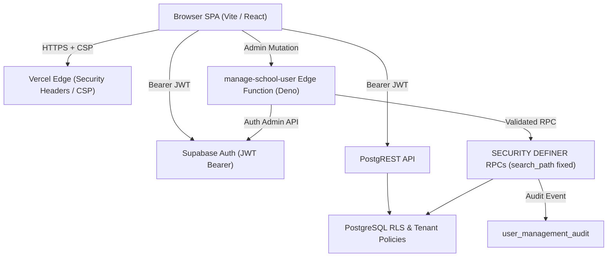

# CAMVIA Security Architecture and Defensive Policy

This document defines the defensive security architecture, tenant isolation model, authorization hierarchy, Edge Function controls, and operational procedures for the production CAMVIA school management platform.

---

## 1. Security Architecture Overview

CAMVIA is a multi-tenant school-management software-as-a-service application built on:
- **Frontend Presentation**: React 19, TypeScript, Vite SPA hosted on Vercel.
- **Identity & Authentication**: Supabase Auth (GoTrue) using bearer JWT tokens.
- **Database Engine & Security**: Supabase PostgreSQL 15+ with PostgreSQL Row Level Security (RLS) and PostgreSQL-level role grants.
- **Serverless Operations**: Supabase Edge Functions (Deno runtime) for privileged administrative operations.

### Defense-in-Depth Model

Security is enforced at multiple concentric layers:
1. **Network & Edge**: Strict Content-Security-Policy (CSP), HSTS, nosniff, and anti-framing headers configured in [`vercel.json`](../vercel.json); origin-validated CORS and payload size limits on Supabase Edge Functions.
2. **Client State**: In-memory credential handling, generic authentication error feedback, client-side progressive attempt throttling, and no sensitive state in local storage.
3. **Database Access Control**: Explicit SQL privilege revocation from `public` and `anon` roles. Unauthenticated actors have zero table access.
4. **Row Level Security (RLS)**: Active RLS on every public table as the ultimate tenant boundary. Even with valid authentication, records are filtered by tenant (`organization_id`, `school_id`), campus, role, and teacher assignment.
5. **Mutation Security**: Critical mutations (student provisioning, user role management, attendance session recording, fee payment processing, and parent communication workflow) are executed through validated `SECURITY DEFINER` RPCs with fixed `search_path`, parameter sanitization, and audit logging.



---

## 2. Authentication Model

### Public Sign-Up Disabled
- Self-registration is strictly disabled.
- The frontend `signUpWithEmail` service rejects public sign-up with a clear denial notice.
- Accounts are provisioned exclusively through administrative invitations issued via the `manage-school-user` Edge Function.

### Session Management & Storage
- Supabase Auth stores user tokens (`sb-<project-ref>-auth-token`) in the browser's storage engine.
- Session tokens are exchanged as `Authorization: Bearer <JWT>` headers over TLS.
- Session restoration checks the live profile in the database. If an account has been deactivated (`status = 'INACTIVE'`), the local session is immediately purged (`signOut()`) and access is revoked.

### Credential Handling & Login Hygiene
- Passwords are used only in transit during form submission and immediately cleared from component memory upon dispatch.
- Authentication responses return generic error messages (`Invalid email or password.`) to prevent account enumeration.
- Client-side progressive lockout throttles failed sign-in attempts (maximum 5 attempts per 5-minute window before enforcing a mandatory cooldown).
- "Forgot Password" actions direct users to school administrators rather than exposing unauthenticated email triggers.

---

## 3. Authorization Hierarchy

CAMVIA enforces four primary institutional roles:

| Role | Scope | Permitted Capabilities | Denied Capabilities |
| --- | --- | --- | --- |
| **Admin** | School-wide | Full school management, invite/manage staff, assign classes, update school/campus settings, create students, view all school data, manage communications. | Cross-school/cross-org access, demoting or deactivating the last active Admin. |
| **Principal** | School-wide | Read-only school-wide student records, attendance, fee summaries, communication approvals. | Adding/editing users, changing user roles/status, altering school settings, fee payment mutations. |
| **Finance** | School-wide | Record fee payments, inspect invoices, manage financial collections and fee reminders. | User administration, academic configuration, marking attendance, academic communications. |
| **Teacher** | Class/Section Assigned | Take attendance for assigned classes, create students within assigned classes, view assigned student 360 profiles, draft communications. | Accessing unassigned students, viewing fee accounts, administrative settings, user management. |
| **Inactive** | None | Denied all operational access. Requests fail closed (0 rows). | All actions. |

---

## 4. Tenant Isolation & Row Level Security (RLS)

All tenant data belongs to a two-tier hierarchy:
1. `organization_id` (the top-level institutional entity)
2. `school_id` (the specific school campus or branch)

### RLS Philosophy
- **Deny by default**: Every table has `ENABLE ROW LEVEL SECURITY`.
- **Zero Anonymous Access**: Privilege grants revoke `SELECT, INSERT, UPDATE, DELETE` from `anon` and `public`.
- **Tenant Context Verification**: Queries join the authenticated caller's profile via `auth.uid()`, verifying `status = 'ACTIVE'`, `organization_id`, and `school_id`.
- **Immutable Tenant Keys**: Foreign keys and update grants restrict users from reassigning rows across schools or organizations.
- **Cross-Tenant Guarantees**: A user registered under School A cannot read or mutate any row belonging to School B, even with valid JWT tokens. Cross-tenant queries return 0 rows or trigger authorization exceptions.

---

## 5. Supabase Edge Functions Security

The `manage-school-user` function handles privileged identity operations:

- **JWT Validation**: Validates the bearer token using `caller.auth.getUser(token)`.
- **Server-Side Authorization**: Invokes `get_current_admin_scope()` to ensure the caller is an active `ADMIN` within their school.
- **Origin-Aware CORS**: Wildcard `*` CORS is restricted; requests are checked against approved application origins.
- **Payload Size Capping**: Payloads exceeding 64KB are rejected with HTTP 413.
- **Burst Rate Limiting**: Administrative mutations are rate-limited to 30 requests per minute per actor.
- **Service-Role Isolation**: The `SUPABASE_SERVICE_ROLE_KEY` is utilized strictly on the server within the Edge Function to invoke Supabase Auth Admin APIs. It is never transmitted to the browser or bundled in frontend assets.

---

## 6. Secrets Management & Hygiene

- **Public Variables**: The frontend bundle requires only:
  - `VITE_SUPABASE_URL`
  - `VITE_SUPABASE_ANON_KEY`
- **Zero Private Secrets in Frontend**: `SUPABASE_SERVICE_ROLE_KEY`, database passwords, integration tokens, and deployment tokens must never be prefixed with `VITE_` or included in repository code.
- **Git Hygiene**: `.env*` files (except `.env.example`) and `*.local` files are ignored by git.
- **Test Credentials**: Passwords in test fixtures are local mock credentials and must never be deployed to production environments.

---

## 7. Incident Response & Credential Rotation

If a secret or credential exposure is suspected:

### Incident Response Steps
1. **Immediate Containment**:
   - Determine the scope of exposure (e.g. Anon Key, Service-Role Key, Database Password, Vercel Access Token, Admin Account).
   - Invalidate affected sessions immediately in Supabase Auth (*Project Settings -> Authentication -> Invalidate all user sessions*).
   - Block rogue administrative actions by deactivating compromised accounts via `update_school_user` or the Supabase Auth dashboard.
2. **Credential Rotation Procedure**:
   - **Supabase Anon / Service-Role Keys**: In Supabase Dashboard (*Settings -> API*), click **Generate new keys**. Update `VITE_SUPABASE_ANON_KEY` in Vercel and `SUPABASE_SERVICE_ROLE_KEY` in Supabase Edge Functions (`supabase secrets set SUPABASE_SERVICE_ROLE_KEY=...`).
   - **Database Password**: In Supabase Dashboard (*Settings -> Database*), click **Reset database password**. Ensure any external migrations/runners are updated with the new connection string.
   - **Vercel Deployment Tokens**: Revoke expired or leaked tokens in *Vercel -> Settings -> Tokens*. Regenerate and update CI/CD secrets.
   - **Edge Function Secrets**: Re-set all secrets using `supabase secrets set --env-file <secure-path>`.
3. **Forensic Audit Review**:
   - Query `public.user_management_audit` for unauthorized events (`USER_CREATED`, `USER_ROLE_CHANGED`, `USER_DEACTIVATED`, `STUDENT_CREATED`).
   - Review Edge Function invocations and Supabase API request logs for unexpected IP origins or unauthorized tenant IDs.
4. **Redeployment**:
   - Redeploy frontend build to Vercel production environment with purged cache.
   - Redeploy Edge Functions via `supabase functions deploy manage-school-user`.

---

## 8. Backup & Restore Guidance

### Automated Backups
- Supabase Pro/Team accounts provide automated daily physical backups retained for 7 to 30 days depending on plan.
- Point-in-Time Recovery (PITR) is recommended for production environments to allow rollbacks to any second within the retention window.

### Pre-Migration Logical Snapshots
Before applying any forward migration (such as `021_production_security_hardening.sql`), execute a logical snapshot using the Supabase CLI:
```bash
# Export full public schema and data snapshot
supabase db dump --data-only -f backup_data_$(date +%Y%m%d_%H%M%S).sql
supabase db dump --schema-only -f backup_schema_$(date +%Y%m%d_%H%M%S).sql
```

### Restoration Procedure
1. **Targeted Table Restoration**: In the event of accidental data corruption or localized failure, restore table-specific data from logical dumps using `psql`:
   ```bash
   psql -h db.<project-ref>.supabase.co -U postgres -d postgres -f backup_table.sql
   ```
2. **Full Point-in-Time Restoration**:
   - Access the Supabase Dashboard under *Project Settings -> Database -> Backups*.
   - Select the target timestamp immediately prior to the incident.
   - Trigger the restore operation. Confirm that all services pause and resume cleanly once the restore completes.
3. **Post-Restoration Validation**:
   - Verify table counts across `profiles`, `students`, `guardians`, `attendance_sessions`, `fee_invoices`, and `communication_messages`.
   - Run verification queries under multiple tenant personas (School A vs School B) to confirm RLS policies and foreign key constraints remain intact.

---

## 9. Deployment Security Checklist

Before deploying any production release:
- [ ] Ensure forward migration [`021_production_security_hardening.sql`](../supabase/migrations/021_production_security_hardening.sql) is reviewed and applied.
- [ ] Confirm Supabase Auth has public signup disabled.
- [ ] Verify Vercel environment variables contain only `VITE_SUPABASE_URL` and `VITE_SUPABASE_ANON_KEY`.
- [ ] Validate that security headers in [`vercel.json`](../vercel.json) are active.
- [ ] Run `npm run build` and `npm run lint` with zero errors.
- [ ] Test cross-tenant isolation between test tenants (School A vs School B).

---

## 10. Reporting Security Issues

To report vulnerabilities or security concerns, contact the CAMVIA security lead at `security@camvia.edu` or open a confidential security advisory. Do not disclose vulnerabilities in public issue trackers.
